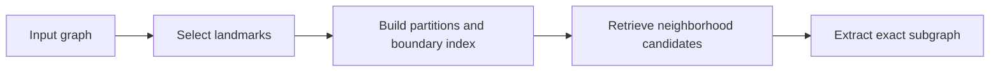

# Sparse Dominating Sets

Efficient algorithms for low-congestion dominating sets and graph neighborhood queries.

This repository accompanies **Sparse Dominating Sets Revisited**. It provides implementations for choosing landmarks that cover a graph with low neighborhood overlap, building partition indexes, and retrieving exact neighborhood subgraphs.

[Supplementary report](supplementary/supplementary_report.pdf) · [Reproduction guide](docs/reproduction.md) · [Experiment map](docs/experiment_map.md)

## Features

- **Efficient landmark selection.** Counter-and-heap implementations of Ratio, Ratio+, Degree and Degree+, together with the reference implementations and CC2FS baseline.
- **Neighborhood retrieval and subgraph extraction.** Landmark partitions and boundary indexes support candidate retrieval and exact vertex/edge output, with memory and file access modes.
- **Experiment tools.** Public-graph preparation, synthetic graph generation, seeded workloads, experiment runners, and scripts for reproducing paper and report figures.

## How it works



A dominating set places landmarks so that every vertex lies within the chosen radius of a landmark. The selection methods seek low congestion: fewer overlapping landmark neighborhoods. The resulting partitions organize the graph for neighborhood queries.

## Quick start

Requirements: Python 3.12 and a C++17 compiler. From the repository root:

```sh
python3 -m venv .venv
. .venv/bin/activate
python -m pip install -r environment/requirements-experiments.txt
python scripts/smoke_test.py
```

This builds the native implementations and runs small graph examples, checking greedy selections, coverage, and complete subgraph outputs.

### Run the query pipeline

```sh
# Linux/GCC; use --serial-reference on macOS
python scripts/build_native.py --with-reference

# Generate a 256-vertex example, landmarks, indexes and queries
python scripts/query_pipeline.py prepare \
  --controls native,fixed-count --exact-control fixed-count \
  --cc-seconds 0.05 --output results/local/demo-inputs

# Retrieve candidates and extract exact subgraphs
python scripts/query_pipeline.py candidates \
  --inputs results/local/demo-inputs --output results/local/demo-candidates
python scripts/query_pipeline.py subgraphs \
  --inputs results/local/demo-inputs --output results/local/demo-subgraphs

# Summarize query measurements
python scripts/summarize_queries.py \
  --runs results/local/demo-subgraphs --output results/local/demo-summary
```

The example runs all nine selector configurations, both access modes, and the original-layout and same-layout BFS controls. Outputs include landmark sets, partition indexes, query results, and summary tables. Choose a new output directory for each run.

## Experiments

The [reproduction guide](docs/reproduction.md) contains commands for:

- Preparing SNAP and LAW WebGraph datasets and generating synthetic graphs.
- Comparing selection quality, LP/IP solutions, implementation time and memory.
- Evaluating larger radii, landmark tie stability, and index budgets.
- Running neighborhood queries and exact subgraph extraction.

The [experiment map](docs/experiment_map.md) connects these commands to the paper and supplementary report.

## Repository structure

| Directory | Contents |
| --- | --- |
| `src/`, `baselines/` | Algorithms, native query engines and reference implementations |
| `scripts/` | Build, data preparation and experiment entry points |
| `configs/`, `data/` | Experiment configurations, dataset sources and small examples |
| `paper/` | Paper figure/table scripts and their inputs |
| `supplementary/` | Technical report PDF, LaTeX sources, figures and tables |
| `docs/` | Reproduction guide and experiment map |

## Supplementary report and figures

The [supplementary report](supplementary/supplementary_report.pdf) presents implementation details, index controls, query comparisons and stability results. To regenerate the displays, create a display environment:

```sh
python3 -m venv .venv-display
. .venv-display/bin/activate
python -m pip install -r environment/requirements-display.txt
python scripts/regenerate_displays.py
python supplementary/build.py
```

PDF compilation requires pdfLaTeX. `python scripts/verify_artifact.py` checks the packaged files and displayed values.

## Acknowledgments

The reference implementation is based on [TheoryInPractice/sparsedomsets](https://github.com/TheoryInPractice/sparsedomsets). See [third-party notices](THIRD_PARTY_NOTICES.md) and [licensing information](LICENSING.md).
